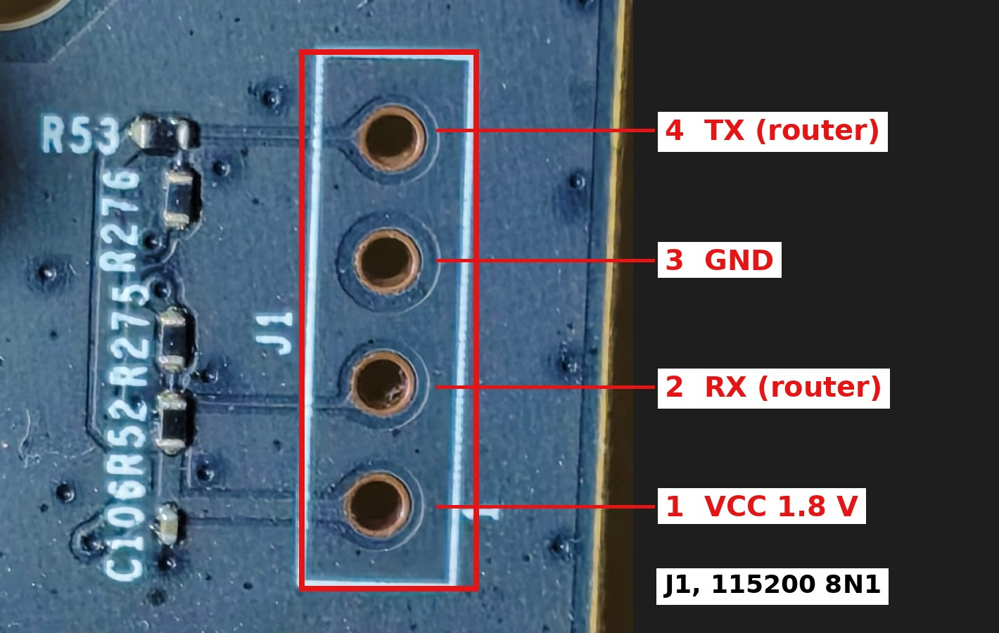
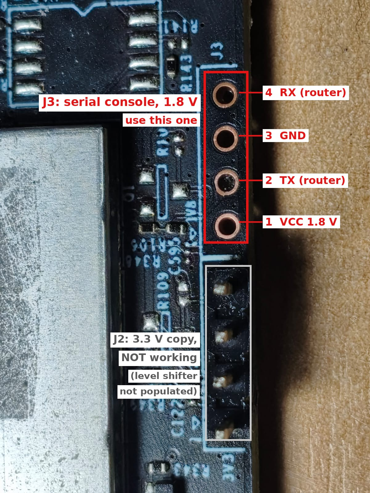
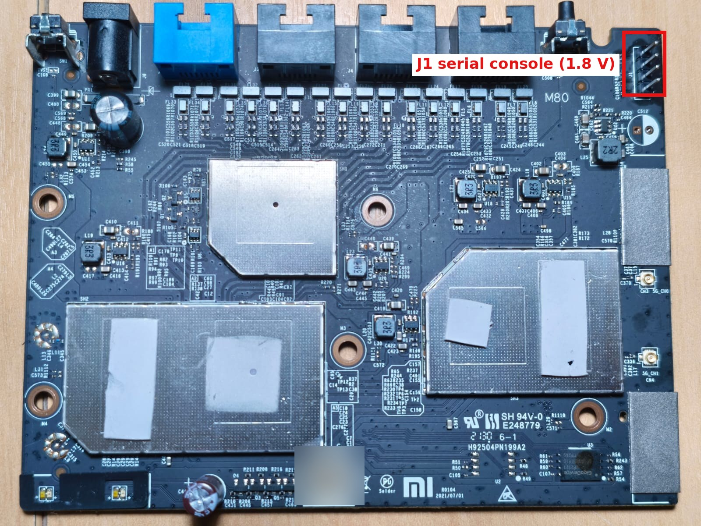

# OpenWrt for Xiaomi AX3000 (RA80) and Xiaomi AX1800 (RM1800)

OpenWrt 25.12.4 images, source patches and full documentation for two Xiaomi
tower routers that are not supported by upstream OpenWrt:

- **Xiaomi AX3000, model RA80** (Qualcomm IPQ5000 + QCN6102), a new port.
- **Xiaomi AX1800, model RM1800** (Qualcomm IPQ6000), based on the port by
  [Diego Macario](https://github.com/macario1983/ax1800-openwrt), with a fix
  for the out-of-memory crashes.

Both run as plain OpenWrt access points and can roam clients between each
other with 802.11k/v/r and `usteer`, replacing Xiaomi's proprietary mesh.

> **Status: experimental.** Each port was tested on one unit. Both units run
> the release images from this repository as access points, and both were
> upgraded to them with `sysupgrade` without touching the stock slot. Read the install guide of
> your device and back up the whole flash before you start. You can brick the
> router, and the calibration data (ART) is unique to each unit.

<p align="center">
  
</p>

Both routers come in nearly identical black tower cases. The photo shows the
AX3000 (Xiaomi product photo).

## The devices

| | Xiaomi AX3000 | Xiaomi AX1800 |
|---|---|---|
| Model code | **RA80** (China) | **RM1800** |
| SoC | Qualcomm IPQ5000 (IPQ5018 family), 2x Cortex-A53 | Qualcomm IPQ6000 (IPQ6018 family), 4x Cortex-A53 |
| RAM | 256 MB | 256 MB |
| Flash | 128 MB NAND, two firmware slots | 128 MB NAND, two firmware slots |
| 2.4 GHz | IPQ5018 integrated, 2x2 802.11ax | IPQ6000 integrated, 2x2 802.11ax |
| 5 GHz | QCN6102, 2x2 802.11ax, 80 MHz | IPQ6000 integrated, 2x2 802.11ax, 80 MHz |
| Ethernet | 1 WAN + 3 LAN, gigabit (QCA8337 switch) | 1 WAN + 3 LAN, gigabit (QCA8075) |
| Serial console | **J1, 1.8 V**, 115200 8N1 | **J3, 1.8 V**, 115200 8N1 (J2 does not work) |
| Stock firmware tested | 1.0.58 (CN) | 1.0.394 (CN) |
| OpenWrt slot | first slot (`rootfs`) | second slot (`rootfs_1`) |
| RAM available as an AP | about 30-50 MB | about 50-80 MB |

Only these model codes were tested. The Xiaomi AX3000T, the Redmi AX3000
(RA81) and the CR880x routers are different hardware: do not flash these
images on them. The RA82 is reported to be the international version of the
RA80 (sold as "Xiaomi Mesh System AX3000"), but it was not tested.

Details for each device, including partition tables, memory maps and U-Boot:

- AX3000 (RA80): [hardware](docs/ax3000-ra80/hardware.md),
  [install](docs/ax3000-ra80/install.md),
  [revert to stock](docs/ax3000-ra80/revert-to-stock.md),
  [what was changed](docs/ax3000-ra80/changes.md),
  [problems found](docs/ax3000-ra80/problems.md)
- AX1800 (RM1800): [hardware](docs/ax1800-rm1800/hardware.md),
  [install](docs/ax1800-rm1800/install.md),
  [revert to stock](docs/ax1800-rm1800/revert-to-stock.md),
  [what was changed](docs/ax1800-rm1800/changes.md),
  [problems found](docs/ax1800-rm1800/problems.md)
- Both: [roaming between the two](docs/roaming.md),
  [building the images](docs/building.md)

## Serial console

Both installs need the serial console, and both consoles are **1.8 V**. A
3.3 V USB adapter can damage the SoC: use one with a VIO pin you can tie to
the board's 1.8 V (for example a CH343 board without its voltage jumper).

| AX3000: J1 pinout | AX1800: J3, not J2 |
|---|---|
|  |  |



## Downloads

Images are attached to the [Releases](../../releases) page, with a
`sha256sums` file per device.

| File | Use |
|---|---|
| `openwrt-qualcommax-ipq50xx-xiaomi_ax3000-initramfs-uImage.itb` | AX3000: boot from RAM over TFTP, first step of the install |
| `openwrt-qualcommax-ipq50xx-xiaomi_ax3000-squashfs-sysupgrade.bin` | AX3000: install from the RAM image, later upgrades |
| `openwrt-qualcommax-ipq50xx-xiaomi_ax3000-squashfs-factory.ubi` | AX3000: raw UBI image of the slot |
| `openwrt-qualcommax-ipq60xx-xiaomi_ax1800-initramfs-uImage.itb` | AX1800: boot from RAM over TFTP, to test before flashing |
| `openwrt-qualcommax-ipq60xx-xiaomi_ax1800-squashfs-factory.ubi` | AX1800: install with `ubiformat` into the second slot |
| `openwrt-qualcommax-ipq60xx-xiaomi_ax1800-squashfs-sysupgrade.bin` | AX1800: upgrades from an installed OpenWrt only |

What is in the images:

- OpenWrt 25.12.4 with the patches in [`patches/`](patches);
- LuCI, `wpad-mbedtls` (802.11k/v/r), `usteer` with its LuCI page, `relayd`;
- LAN at **192.168.31.1/24** (the same address as the stock firmware), DHCP
  server on;
- **no root password**: set one on the first login;
- Wi-Fi disabled until you configure it, with 802.11k/v already enabled.

Kernel modules from the official OpenWrt package repository will not install
on these builds (the kernel is different). Everything the hardware needs is
already in the image.

## What had to be fixed

The short version. Each device's `changes.md` and `problems.md` has the full
story, with the logs.

**AX3000 (RA80)**, new port based on the CMCC PZ-L8 (same platform):

- the NAND needs **8-bit ECC**; with the 4-bit default every read fails
  (`EBADMSG`), the MACs come out random and the flashed image would not be
  readable by the stock U-Boot;
- both radios crashed the Wi-Fi firmware (`phyrf_bdf.c:605`) with the stock
  board files; clearing **one byte (0x45c)** in them fixes it
  ([`scripts/bd-patch.py`](scripts/bd-patch.py));
- calibration data is extracted from ART as is, because it already carries the
  radio MACs;
- the stock firmware has the serial console and SSH disabled; both have to be
  enabled first.

**AX1800 (RM1800)**, on top of the base port:

- under load the router **ran out of memory** after a few minutes: the Wi-Fi
  went down and it never rebooted by itself. Linux had only 158 MB, against
  194 MB on the stock firmware;
- fixed with a memory layout that matches the stock one (178.8 MB for Linux)
  and a low-memory RX profile for the ath11k driver: available memory two
  minutes after boot went from 28 MB to 80 MB;
- the 3.3 V console header J2 is dead from the factory; J3 (1.8 V) works.

## Building

```sh
scripts/build.sh ax3000
scripts/build.sh ax1800
```

The script clones OpenWrt v25.12.4, applies the patches, uses pinned feeds and
leaves the images in `out/<device>/`. See [docs/building.md](docs/building.md).

## Credits

- [OpenWrt](https://openwrt.org) and the `qualcommax` target maintainers.
- [Diego Macario](https://github.com/macario1983/ax1800-openwrt) for the
  AX1800 port (patch 0001 is his work).
- The CMCC PZ-L8 support in OpenWrt, used as the template for the AX3000.
- The OpenWrt forum thread where the board-file byte fix was found for a
  similar IPQ5018 device.
- [xmir-patcher](https://github.com/openwrt-xiaomi/xmir-patcher), used to
  enable SSH and the serial console on the stock firmware.

## License

The patches and scripts are released under the
[GPL-2.0](LICENSE), like OpenWrt. The Wi-Fi board data files inside the AX3000
patch were extracted from Xiaomi's stock firmware and modified for
interoperability, as OpenWrt does for other devices.

The tower photo is a Xiaomi product image; the board photos were taken for
this project.

This project is not affiliated with Xiaomi or Qualcomm. Use it at your own
risk.
