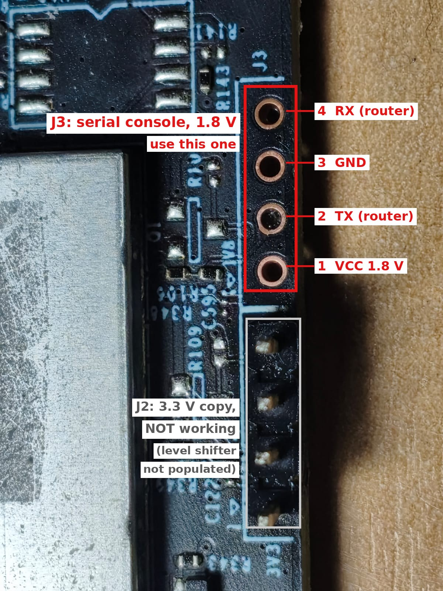

# Xiaomi AX1800 (RM1800): hardware

This is the black Xiaomi AX1800 tower, model `RM1800`. The base port calls it
"Xiaomi Redmi AX1800", and that string is also the device tree `model`, but the
`bdata` partition of the tested unit says `model=RM1800` and the U-Boot build is
named `rm1800`. The white four-antenna Redmi AX5 (RA67) is a different device and
is not covered here.

Everything below was observed on one unit unless it says otherwise. Facts taken
only from the base port's documentation are marked "(base port)".



## Specifications

| Item | Value |
|---|---|
| Model | Xiaomi AX1800, `RM1800` (from `bdata`) |
| Device tree | `compatible = "xiaomi,ax1800", "qcom,ipq6018"`, `model = "Xiaomi Redmi AX1800"` |
| OpenWrt profile | `xiaomi_ax1800`, target `qualcommax/ipq60xx` |
| SoC | Qualcomm IPQ6000 (IPQ6018 family), 4x Cortex-A53 |
| RAM | 256 MB at `0x40000000` (DDR3L according to the base port, not verified) |
| Flash | 128 MB NAND (GigaDevice, seen in the stock boot log) on the QPIC controller, 8-bit bus, 4-bit ECC per 512 bytes, 2048-byte pages, 128 KiB erase blocks |
| Wi-Fi | Integrated IPQ6018 radios, driver `ath11k` (AHB): `radio0` 5 GHz 2x2 (HE80), `radio1` 2.4 GHz 2x2 (HE20) |
| Wi-Fi firmware | runs on the Q6/WCSS core, loaded by `remoteproc` from `IPQ6018/q6_fw.mdt` (base port) |
| Wi-Fi calibration | `0:ART` offset `0x1000`, 64 KiB (`0x10000`) |
| Board data file | `board-2.bin`, variant `Xiaomi-AX1800`, 65,640 bytes, package `ipq-wifi-xiaomi_ax1800` |
| Ethernet | QCA8075 5-port PHY package over PSGMII; 3x LAN + 1x WAN, all gigabit |
| Console | `blsp1_uart3`, 115200 8N1, 1.8 V logic on J3 (see below) |
| Bootloader | U-Boot 2016.01 with two rootfs slots (A/B) |

### Ethernet port mapping

From the device tree (`switch_lan_bmp = ESS_PORT2|3|4`, `switch_wan_bmp = ESS_PORT5`,
`MAC_MODE_PSGMII`):

| Linux name | ESS port | QCA8075 PHY address | MAC address source |
|---|---|---|---|
| `lan1` | 2 | 1 | `0:ART` offset `0x6` |
| `lan2` | 3 | 2 | `0:ART` offset `0x6` |
| `lan3` | 4 | 3 | `0:ART` offset `0x6` |
| `wan` | 5 | 4 | `0:ART` offset `0x18` (label MAC, `label-mac-device = &dp5`) |

MDIO uses GPIO 64 (MDC) and GPIO 65 (MDIO); the QCA8075 reset is GPIO 75, active
low. A kernel message about `90000.mdio-1:03` (PHY address 3) matched the port
named `lan3` on the tested unit. The order of the physical jacks against these
names was not checked further.

### LEDs, buttons and GPIOs

| Function | GPIO | Polarity | OpenWrt use |
|---|---|---|---|
| Status LED, blue | 29 | active high | `led-running` |
| Status LED, yellow | 30 | active high | `led-boot`, `led-failsafe`, `led-upgrade` |
| Network LED, blue | 31 | active high | function `net` |
| Network LED, yellow | 32 | active high | function `net` |
| Reset button | 19 | active low | `KEY_RESTART` |
| MDC / MDIO | 64 / 65 | | Ethernet PHY management |
| QCA8075 reset | 75 | active low | |

## Serial console

There are two 4-pin headers next to each other. Only one works.

| Header | Level | State |
|---|---|---|
| **J3** | **1.8 V** | Working console, wired straight to the SoC UART. Only pin 1 is marked on the silkscreen (`1V8`). |
| J2 | 3.3 V | A level-shifted copy of J3 that **does not work**: the level shifter between them (Q1, Q2, R107, R109) is not populated. Its pin 2 shows 3.3 V only through a pull-up. Tested with a CH340 adapter: zero bytes received at any baud rate. |

The base port's documentation describes a "3.3 V UART" on pads. On this unit
that describes J2, which is dead. Use J3.

**Never connect a 3.3 V (or 5 V) adapter to J3.** J3 is a 1.8 V signal that goes
directly to the SoC.

### Pinout

Counting from pin 1, the hole marked `1V8` at the end closest to J2:

| J3 pin | Signal |
|---|---|
| 1 (marked `1V8`) | VCC, 1.8 V reference (use it for the adapter's I/O side) |
| 2 | TX (router) |
| 3 | GND |
| 4 (closest to the `J3` label) | RX (router) |

On the tested unit GND was found with a continuity test to the metal shield,
and TX by moving the adapter's RX wire between the two remaining holes until the
boot log appeared. If your unit does not show a log, repeat those two checks
before anything else.

The photo above shows J3 framed in red with each pin labelled.

### Adapter wiring at 1.8 V

The tested adapter is a CH343 (USB ID `1a86:55d3`, "USB Single Serial"). It shows
up as `/dev/ttyACM0` (driver `cdc_acm`), not as `ttyUSB`. Its VIO jumper only
offers 5 V and 3.3 V, so it was wired like this:

| Adapter | J3 |
|---|---|
| VIO jumper | **removed** |
| VIO pin | pin 1 (`1V8`) |
| GND | GND |
| RX | router TX |
| TX | router RX |
| VCC / 5 V | not connected (the router uses its own power supply) |

Do not leave the VIO jumper in place while VIO is wired to J3: that ties the
adapter's 3.3 V or 5 V rail to the router's 1.8 V rail and can destroy the SoC.
Any adapter with a true 1.8 V mode or an external VIO/VREF input should work the
same way; only the CH343 was tested.

### Settings and use

115200 8N1, no flow control. For example:

```sh
picocom -b 115200 --imap spchex,8bithex --logfile serial.log /dev/ttyACM0
# quit: Ctrl+A, then Ctrl+X
```

- On the stock firmware the console only accepts input when `uart_en=1` is set
  in the U-Boot environment. The stock Linux console then asks to "press Enter
  to activate this console" and gives a root shell.
- U-Boot only stops for a key press when `boot_wait=on` (see below).
- On OpenWrt, kernel messages at all levels reach the console (`kernel.printk`
  was `7 4 1 7` on the tested unit), so OOM reports and panics show up there.
  `logread` lives in RAM and is lost on a power cycle, so a console logged to a
  file is the best black box this device has.

## U-Boot

| Item | Value |
|---|---|
| Version | U-Boot 2016.01, build `rm1800_ota_publish-133` |
| Prompt | `IPQ6018#` |
| `boot_wait` | **off** by default (`bootwait is off` in the boot log): U-Boot cannot be interrupted |
| Enabling it | from Linux on the stock firmware: `boot_wait=on`, `uart_en=1`, `bootdelay=3` (xmir-patcher set all three on the tested unit) |
| Interrupting | send a space on the console during `bootdelay` |
| Environment | `0:APPSBLENV` (mtd6); OpenWrt `/etc/fw_env.config`: `/dev/mtd6 0x0 0x10000 0x20000` |
| FIT configuration used | `config@cp03-c1` (same in the stock image and in this port) |
| TFTP | works from any LAN port |
| Load address used | `0x44000000` |
| Addresses used for TFTP | router `192.168.31.10`, TFTP server `192.168.31.100` (set with `setenv ipaddr` / `setenv serverip`) |
| Known warning | `MAC from ART is not valid` on every boot; see [problems.md](problems.md) |

On the stock firmware, `nvram` is Xiaomi's front end to this same U-Boot
environment (`nvram set ...; nvram commit`). On OpenWrt the equivalent is
`fw_printenv` / `fw_setenv`.

## NAND partitions

The OpenWrt device tree mirrors the 16 stock partitions without changes. The mtd
numbers below are the same on the stock firmware and on OpenWrt.

| mtd | Label | Offset | Size | Contents | OpenWrt access |
|---|---|---|---|---|---|
| 0 | `0:SBL1` | `0x000000` | 1.5 MiB | SBL bootloader, first stage in flash | read-only |
| 1 | `0:MIBIB` | `0x180000` | 1 MiB | boot partition table | read-only |
| 2 | `0:QSEE` | `0x280000` | 3.5 MiB | TrustZone | read-only |
| 3 | `0:DEVCFG` | `0x600000` | 512 KiB | device configuration | read-only |
| 4 | `0:RPM` | `0x680000` | 512 KiB | RPM firmware | read-only |
| 5 | `0:CDT` | `0x700000` | 512 KiB | DDR configuration | read-only |
| 6 | `0:APPSBLENV` | `0x780000` | 512 KiB | U-Boot environment (slot flags) | read-write |
| 7 | `0:APPSBL` | `0x800000` | 1.5 MiB | U-Boot | read-only |
| 8 | `0:ART` | `0x980000` | 512 KiB | Wi-Fi calibration and MAC addresses. Unique per unit. | read-only |
| 9 | `bdata` | `0xa00000` | 512 KiB | factory data: MAC addresses, model (`model=RM1800`), country, serial number. Unique per unit. | read-only |
| 10 | `crash` | `0xa80000` | 512 KiB | stock crash log | read-only |
| 11 | `crash_syslog` | `0xb00000` | 512 KiB | stock crash log | read-only |
| 12 | `rootfs` | `0xb80000` | 44.5 MiB | **slot A** (UBI) | read-write |
| 13 | `rootfs_1` | `0x3800000` | 44.5 MiB | **slot B** (UBI) | read-write |
| 14 | `overlay` | `0x6480000` | 22.5 MiB | stock overlay, unused by OpenWrt | read-only |
| 15 | `cfg_bak` | `0x7b00000` | 512 KiB | stock configuration backup | read-only |

Notes:

- The OpenWrt overlay is not mtd14. It is the `rootfs_data` UBI volume inside the
  active slot. After a flash, slot B held the volumes `kernel` (5.2 MB), `rootfs`
  (7.0 MB) and `rootfs_data` (27.9 MB).
- The stock firmware lists 20 mtd devices: the 16 above plus four more from mtd16
  on. mtd16 (`kernel`) holds the stock FIT image with its device trees. The four
  extra devices were included in the backup; what they map to was not analysed.
- Because ART and bdata are read-only in the OpenWrt device tree, OpenWrt can
  neither damage nor restore them.

## Boot slots and environment flags

U-Boot boots one of two UBI slots and passes the slot name on the kernel command
line. Booted from slot B, the command line was:

```
ubi.mtd=rootfs_1 root=mtd:ubi_rootfs rootfstype=squashfs rootwait uart_en=1 root=/dev/ubiblock0_1
```

The trailing `root=/dev/ubiblock0_1` comes from the OpenWrt device tree
(`bootargs-append`). A TFTP-booted initramfs has no `ubi.mtd=` argument.

| Flag | Meaning as used by this port |
|---|---|
| `flag_boot_rootfs` | slot to boot: `0` = `rootfs` (slot A, mtd12), `1` = `rootfs_1` (slot B, mtd13) |
| `flag_last_success` | last slot that booted successfully |
| `flag_boot_success` | `1` when the current boot was confirmed |
| `flag_ota_reboot` | apparently used by the stock OTA updater (not verified); this port keeps it at `0` |
| `flag_try_sys1_failed`, `flag_try_sys2_failed` | failure markers per slot |

On every OpenWrt boot from NAND, `/etc/init.d/bootcount` reads `ubi.mtd=` and
writes all six flags for the current slot, then logs
`confirmed boot from rootfs slot 1`. Without that confirmation U-Boot treats the
boot as failed and can fall back to the other slot. The base port's notes quote
a U-Boot string, `INFO: ota reboot failed, swap to old firmware!`, but the exact
failover rules were not confirmed.

On the tested unit the stock firmware booted from slot A, and OpenWrt was
installed in slot B.

## Memory map

256 MB of RAM start at `0x40000000`. Part of it is reserved (`no-map`) for the
boot chain, TrustZone, NSS and, above all, the Q6/WCSS core that runs the Wi-Fi
firmware. The Wi-Fi firmware sizes its own working memory from the "FW memory
mode" passed in the device tree, so the size of `q6_region` and the mode must
match: mode 0 = 85 MB, mode 1 = 55 MB, mode 2 = 40 MB (values from the OpenWrt
and stock device trees). Shrinking the region while keeping mode 1 would let the
firmware write into Linux memory without any visible error.

| Region | Address | Stock (QSDK 256M profile) | Base port (`ipq6018-512m.dtsi`) | This repository (256 MB layout) |
|---|---|---:|---:|---:|
| small reservation | `0x00060000` | none | 24 KiB | 24 KiB |
| NSS (`nss_region`) | `0x40000000` | 8 MB | 16 MB | 8 MB |
| U-Boot | `0x4a100000` | 4 MB | 4 MB | 4 MB |
| SBL | `0x4a500000` | 1 MB | 1 MB | 1 MB |
| TrustZone | `0x4a600000` | 4 MB | 4 MB | 4 MB |
| SMEM | `0x4aa00000` | 1 MB | 1 MB | 1 MB |
| Q6/WCSS firmware (`q6_region`, stock name `wcnss`) | `0x4ab00000` | 40 MB | 55 MB | 40 MB |
| Q6 ETR dump + two reserved blocks | `0x4d300000` | 3 MB | inside the 55 MB | 3 MB |
| **Total reserved** | | **61 MB** | **81 MB** | **61 MB** |
| FW memory mode | | 2 (`qcom,tgt-mem-mode`, log `cnss: mem mode : [2]`) | 1 | 2 |
| Kernel `Memory:` line, NAND boot | | `194292K/204800K` (about 194 MB) | `158460K/262144K` (about 158.5 MB) | `178816K/262144K` (about 178.8 MB) |
| Kernel `Memory:` line, initramfs | | | `150840K/262144K` | `171284K/262144K` |

The stock layout was read from the device tree inside the stock FIT image
(mtd16, configuration `config@cp03-c1`). The Wi-Fi firmware used by OpenWrt
(`WLAN.HK.2.5.0.1-03982`) occupies only `0x4ac00000`-`0x4b1f2000` (about 6 MB of
code); the rest of `q6_region` is its working memory.

Before the fix, the OOM report showed `managed:161144kB` and `25250 pages
reserved` out of 65536. Why the base port used the 512 MB layout and what the
256 MB layout changes in practice is explained in [changes.md](changes.md).

## Software versions seen

| Component | Version |
|---|---|
| Stock firmware | 1.0.394 (CN), kernel 4.4.60 |
| Stock Wi-Fi driver | QCA `cnss` (`qcom,cnss-qca6018`), FW memory mode 2 |
| U-Boot | 2016.01, build `rm1800_ota_publish-133` |
| OpenWrt | 25.12.4, `r32933-4ccb782af7`, kernel 6.12.87 |
| mac80211 / ath11k | backports from Linux 6.18.26 |
| ath11k firmware | `WLAN.HK.2.5.0.1-03982-QCAHKSWPL_SILICONZ-3` (`fw_version 0x25008f8e`, built 2024-03-01) |
